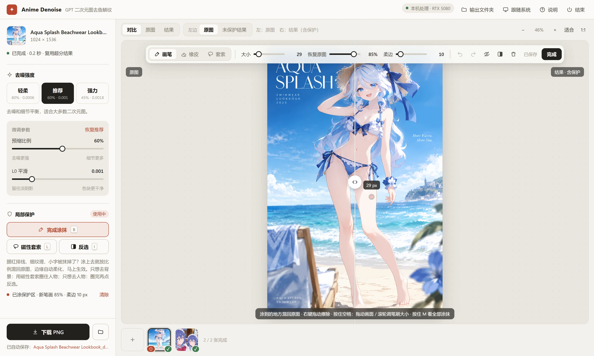
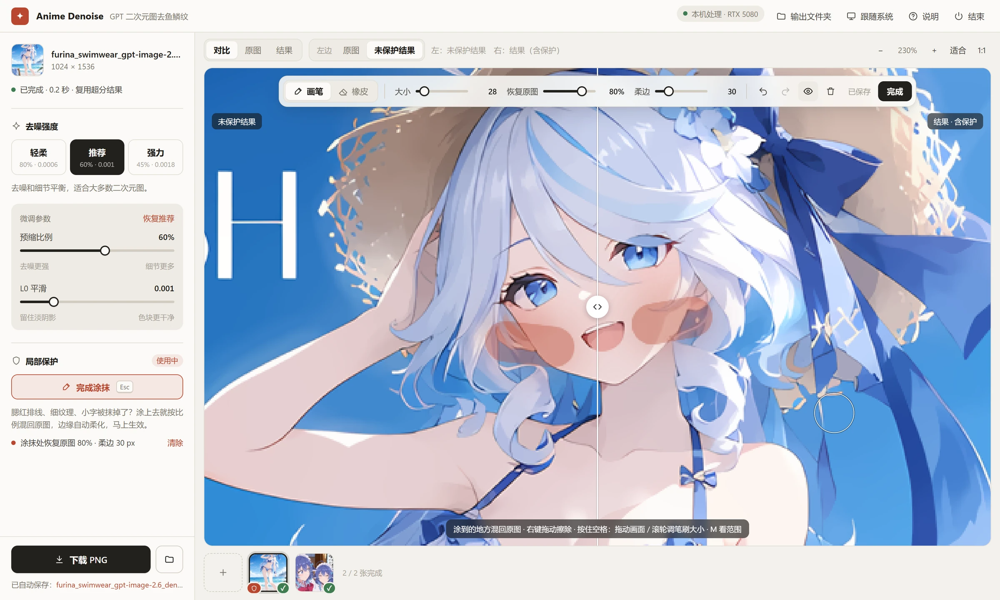
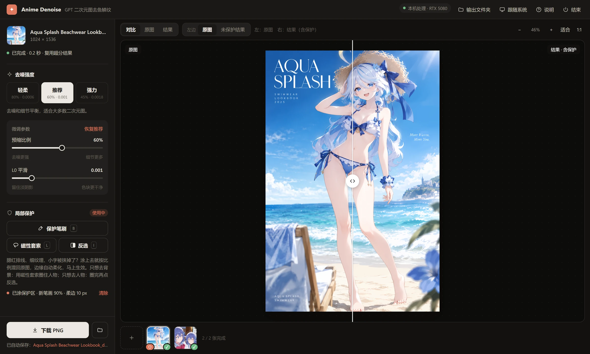

# gpt-anime-denoise

去掉 GPT 生图（gpt-image-2 / 2.5 / 2.6、ChatGPT、Codex 内置 image_gen）在**二次元 / 番剧画风**图里留下的**鱼鳞状噪点**。

Removes the fish-scale texture that OpenAI's GPT image models leave in anime and TV-anime style images, without redrawing the picture.

**默认推荐：ESRGAN 缩 60% + L0 0.001** —— 对动漫与番剧画风有奇效。

**视频讲解（B 站）：** https://www.bilibili.com/video/BV1EC4B6rEMs/

> 如果您用本项目做出了满意的作品，麻烦在简介里 credit 本项目 [gpt-anime-denoise](https://github.com/CXP-2024/gpt-anime-denoise) 和作者 B 站 UP 主 [hihihihi202](https://space.bilibili.com/3546568969947566)。

## 交流群

QQ 群：**1130507071**，欢迎来做技术交流。群里聊 AI 视频、AI 建模、AI 绘画等内容，主打 agent base（dsh、Codex、Claude Code）+ 本地模型。

## 效果

左边去噪前，右边默认方案去噪后。**请点开看原尺寸**，缩小后鳞纹看不出来。

### 粉彩白底插画


### 电影感宽幅场景


### 番剧截帧质感


这张缩小看不明显，**请注意看刘海部分**。下面是左边角色右眼和刘海的局部，最近邻放大 3 倍（无损，没有插值平滑）：去噪前刘海的发丝色块里布满细碎的鳞状起伏，去噪后变成干净的平涂，发丝线条和高光的位置不变。


### 八种方法对比

每张都是原尺寸并排：原图、L0 0.0005、L0 0.001、APISR、CUGAN 缩 60%、CUGAN 缩 60% + L0、ESRGAN 缩 60%、**ESRGAN 缩 60% + L0（默认）**。用 `--all` 可以对自己的图生成同样的对比图，挑最合适的一种。


## 图形界面

不想敲命令的话，用本机网页工具（依赖和命令行版一样，见下面「命令行用法」的安装那一行）：

```bash
python denoise_app.py      # 自动在浏览器打开 http://127.0.0.1:7865/
```

Windows 上也可以双击 `去噪工具.bat`（默认用 PATH 里的 `pythonw`，需要时在文件里改成自己的 Python）。图片只在本机处理，不会上传；结果自动存到 `outputs/`（可用环境变量 `ANIME_DENOISE_OUTPUT` 改位置）。



- **拖进来就去噪**：拖入、点击选择或 Ctrl+V 粘贴，可以一次放多张，底部缩略图排队依次处理；RTX 5080 上一张约 1 秒。
- **三档强度 + 微调**：轻柔（80% · 0.0006）/ 推荐（60% · 0.001）/ 强力（45% · 0.0018），下面的「微调参数」可以单独调预缩比例和 L0；松手就重跑，只改 L0 时复用超分结果，约 0.3 秒。正在处理时改参数，旧任务会立刻中止，直接按新参数重来。每张图记住自己的参数。
- **对比查看**：对比 / 原图 / 结果三种视图；拖分割线比较，或按 `X` 在全屏原图和全屏结果之间直接切换（没有分割线）；滚轮缩放（200% 以上按原像素显示），拖动平移，按住 Z 临时看原图。
- **保存**：右边显示的就是下载的 PNG，尺寸和原图一样，透明背景会保留；同时自动存一份到 `outputs/`，左下角点文件名就能在文件夹里定位。



- **局部保护笔刷**：腮红排线、细纹理、小字这类不想被抹平的地方，用画笔涂上（上图涂在两边脸颊的腮红上，淡红色就是涂过的范围和强度）。涂过的地方按比例混回原图，实时生效，不用重跑模型。
  - 画面上方浮出工具条：画笔 / 橡皮、大小（默认 14 px，按住空格转滚轮可以细调）、恢复原图比例、柔边（默认 10 px，只向外渐变，0 是硬边）、撤销 / 重做、显示范围、清除。
  - 每一笔有自己的强度：「恢复原图」设的是接下来这几笔的比例（默认 90%，100% 就是完全不动），同一张图里可以有 95% 的地方和 40% 的地方；淡红色越深表示混回原图越多，柔边的渐变也直接显示出来。在涂过的地方再涂，会改成新的比例。
  - 左边可以切到「未保护结果」，直接对比加保护前后。淡红范围默认「涂完自动隐藏」：画的时候显示，松手后约 0.7 秒淡出；工具条上的眼睛按钮可改成一直显示，任何时候按住 M 都能看到全部已涂的地方。
  - 去噪前也可以先涂；重新去噪后保护区会自动套用。



- **外观**：跟随系统 / 浅色 / 深色。
- **快捷键**：`B` 开始 / 结束涂抹（橡皮状态下先切回画笔），`E` 橡皮，`Esc` 也能结束涂抹，按住空格转滚轮或 `[` `]` 调画笔大小，右键拖动擦除，按住空格拖动画面，`1` `2` `3` 切换视图，`X` 全屏原图 / 结果互切，`←` `→` 切换图片，`Ctrl+S` 下载，`Ctrl+Z` 撤销（加 Shift 重做），`?` 打开说明。
- 网页工具的强度预设、浮动笔刷工具条、多图队列、深色外观、处理进度和自动保存等设计参考了 [@AkihiM](https://github.com/AkihiM) 在 [PR #1](https://github.com/CXP-2024/gpt-anime-denoise/pull/1) 里的网页界面，感谢。

## 命令行用法

```bash
pip install -r requirements.txt          # 先按 pytorch.org 装好对应 CUDA 的 torch
python denoise.py image.png              # 默认方案，输出在 image_denoise/
python denoise.py image.png --all        # 7 种候选 + 一张 4×2 对比图
python denoise.py ./folder --out ./clean # 批量
python denoise.py image.png --l0 0.002   # 自行调节 L0 强度
```

**L0 的值可以按图自行调节。** 0.001 只是我们推荐的值，不是唯一答案：
- 纹理还残留 → 调大（如 0.0015、0.002）；
- 淡阴影、腮红、细渐变被抹平或出现色阶 → 调小（如 0.0007、0.0005）；
- 实测 0.01 已经会把腮红抹掉，一般在 0.0005–0.002 之间找。

`--l0` 作用于所有带 `_l0` 的方法（默认方案、`cugan60_l0`），`--all` 的对比图也会按这个值标注。

支持 PNG、JPEG、WebP、BMP、GIF（静态）、TIFF、AVIF。透明背景、EXIF 方向和 RGB 图的色彩配置（ICC）会保留，16 位图会正确转成 8 位，CMYK 按内嵌配置转成 RGB；输出都是 PNG。

模型在第一次运行时自动下载到 `~/.cache/gpt-anime-denoise`（共约 100 MB，带 SHA-256 校验），也可以用 `--models` 指定已有目录。有 NVIDIA 显卡时自动用 GPU，没有就用 CPU。

实测速度（1024×1536，约 157 万像素，和 Codex 默认出的 16:9 图 1672×941 差不多大；默认方案）：

| 设备 | 超分（缩 60% 后放大） | L0 平滑 | 合计 |
|---|---|---|---|
| RTX 5080 16GB | 0.6–1.4 秒 | 0.3–0.5 秒 | 约 1–2 秒 |
| 只用 CPU（Ryzen 7 9850X3D） | 13 秒 | 15 秒 | 约 28 秒 |

- 有 NVIDIA 显卡时 L0 也在显卡上跑（torch.fft，双精度），输出和 CPU 版逐像素一样。显存不够时 L0 会自动退回 CPU。
- 命令行每次启动要加载 Python 和 torch，单张总耗时约 5 秒；批量处理时只加载一次。
- GPU 超分在显存够时整图一次处理（这个尺寸峰值约 8.7 GB）；放不下时自动分块处理，大图也不会卡住（2400×3600 约 4 秒、峰值 4 GB）。

## 原理

默认方案分两步：

1. **先缩到 60% 再用动漫超分放回原尺寸。** 鳞纹是很细很密的纹样，缩小时几个像素被平均成一个，纹样基本消失；Real-ESRGAN anime 6B 放大时按它学过的干净动漫图重新补细节，所以 GPT 的纹理不会被带回来。
2. **再做一次轻度 L0 平滑（λ = 0.001）。** L0 梯度最小化（Xu et al. 2011）让整张图里"颜色有变化的像素"尽量少：色块内部的小起伏被压成一块平色，真正的线条和色块边缘因为跳变大而原样保留，不会变软。它是纯数学优化，不会编造细节，眼睛、腮红的位置和颜色都不变。λ 越大抹得越平，太大（如 0.01）会把淡渐变和腮红抹掉；默认 0.001，可用 `--l0` 调节。

其他候选：

| 方法 | 说明 |
|---|---|
| L0 0.0005 / 0.001 | 只做 L0 平滑，改动最小 |
| APISR | 直接 2x 超分（不先缩小），本身已经很干净，不需要再叠 L0 |
| CUGAN 缩 60%（+ L0） | Real-CUGAN 降噪 3 档，比 ESRGAN 抹得更平 |
| ESRGAN 缩 60%（+ L0） | 默认方案 |

### 试过但效果不好的方法

- [Larryvrh/gpt-image-2-artifact-cleaner](https://github.com/Larryvrh/gpt-image-2-artifact-cleaner)：专门针对 GPT Image 2，但 α 开到 1.0 也只改善一点。
- 2x-AnimeSharpV4：几乎不改动画面。
- 导向滤波、双边滤波：会把画面抹糊。
- 1x-DitherDeleterV3-Smooth、1x-DeSharpen：都不如单用 L0。
- 扩散模型低强度重绘（img2img）、ControlNet：能去掉纹理，但会重画眼睛等小细节，角色设计会变。
- 频域陷波：这种纹理在频谱上没有明显的周期尖峰，没有可挖的频点。

## 作为 Claude Code / Codex skill 使用

把整个目录放进 `.claude/skills/gpt-anime-denoise/`（或 Codex 的 skills 目录），`SKILL.md` 会告诉 agent 在 GPT 出完二次元图后跑这一步。

## 许可

- 代码：MIT（见 `LICENSE`）。
- 模型不随仓库分发，脚本从原作者发布地址下载，使用时遵守各自的许可：[Real-ESRGAN](https://github.com/xinntao/Real-ESRGAN)（BSD-3-Clause）、[APISR](https://github.com/Kiteretsu77/APISR)（GPL-3.0）、[Real-CUGAN](https://github.com/bilibili/ailab)。
- 示例图由 GPT 生成，只作效果演示：
  - 鲸娘 DeepSeek 角色设计来自 [ZipZipPipe《AI娘化》](https://www.pixiv.net/artworks/148186519)（作者声明 CC BY-NC-SA 4.0）。
  - 芙宁娜是《原神》角色（© HoYoverse），属于同人图。
  - 番剧截帧那张以 TV 动画《わたしが恋人になれるわけないじゃん、ムリムリ！》第 4 话官方先行场面图为构图参考（© みかみてれん・竹嶋えく／集英社・わたなれ製作委員会），画面里右下角的小字是生成时产生的乱码。
  - 示例图不适用代码的 MIT 许可，不可商用。
